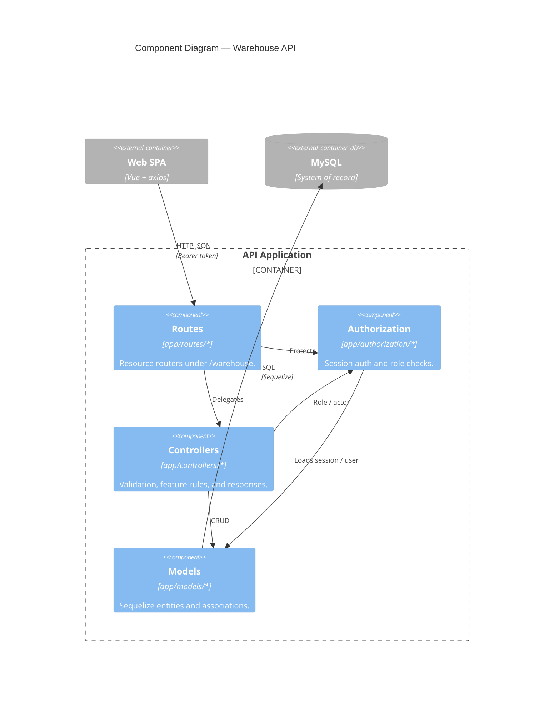

# C4 Level 3 — Backend components

Express app along the HTTP path.

## Notes

- Missing or invalid session → `401`. Insufficient role → `403`. Unknown id → `404`.
- Controllers ignore client-supplied `createdBy`.

**Related:** [ADR-0002](../adr/0002-security-and-role-architecture.md) · [ADR-0006](../adr/0006-node-express-api.md) · [ADR-0008](../adr/0008-sequelize-orm.md)
