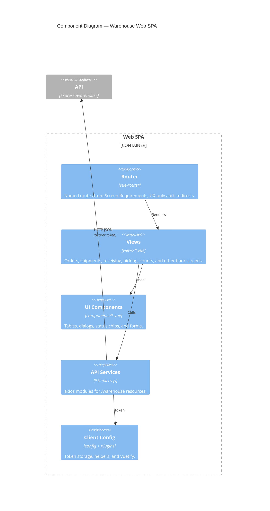

# C4 Level 3 — Frontend components

Vue SPA along the user interaction and API path.

## Notes

- Router guards and hidden manager buttons are UX only; the API enforces roles.
- Optional mockups live in [../Ui](../Ui/README.md).

**Related:** [ADR-0004](../adr/0004-vue-frontend-framework.md) · [ADR-0005](../adr/0005-vuetify-ui-library.md)
