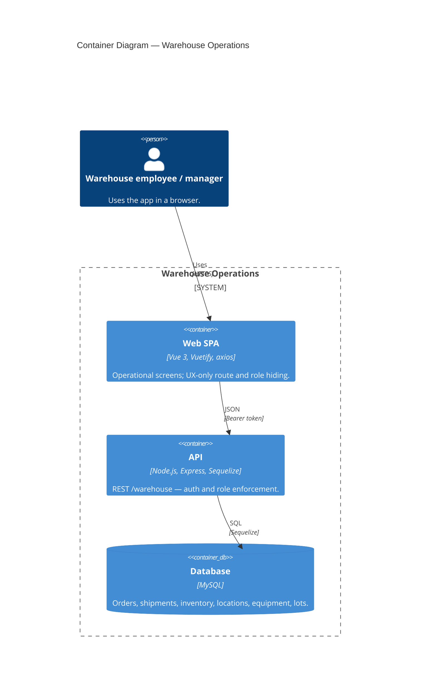

# C4 Level 2 — Containers

Browser SPA talks to a REST API. The API enforces auth and roles. MySQL holds warehouse rows.

## Notes

- API routes are mounted under `/warehouse/`.
- The API sets actor fields from `req.user.id` and checks `req.user.role`. The browser never supplies a trusted `createdBy`.
- Shared warehouse tenancy: employees can read operational records; manager-only writes return `403`.

**Related:** [ADR-0001](../adr/0001-client-server-warehouse-architecture.md) · [ADR-0002](../adr/0002-security-and-role-architecture.md) · [ADR-0007](../adr/0007-rest-json-api.md)
