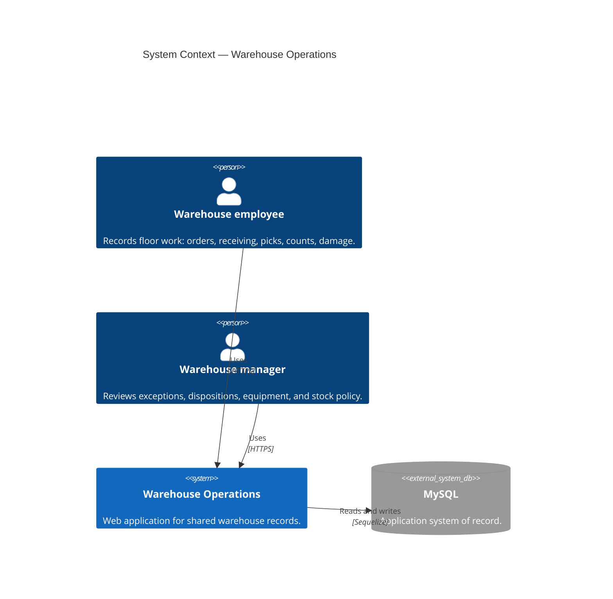

# C4 Level 1 — System context

Warehouse employees and managers share operational records (orders, inventory, locations) through one web application. There are no external SaaS dependencies in this draft.

## Notes

- Operational data is **shared** for this warehouse (not private per user).
- The Vue SPA and Express API sit inside the warehouse system; the [container diagram](./c4-container.md) expands that boundary.

**Related:** [ADR-0001](../adr/0001-client-server-warehouse-architecture.md) · [ADR-0003](../adr/0003-mysql-relational-database.md)
