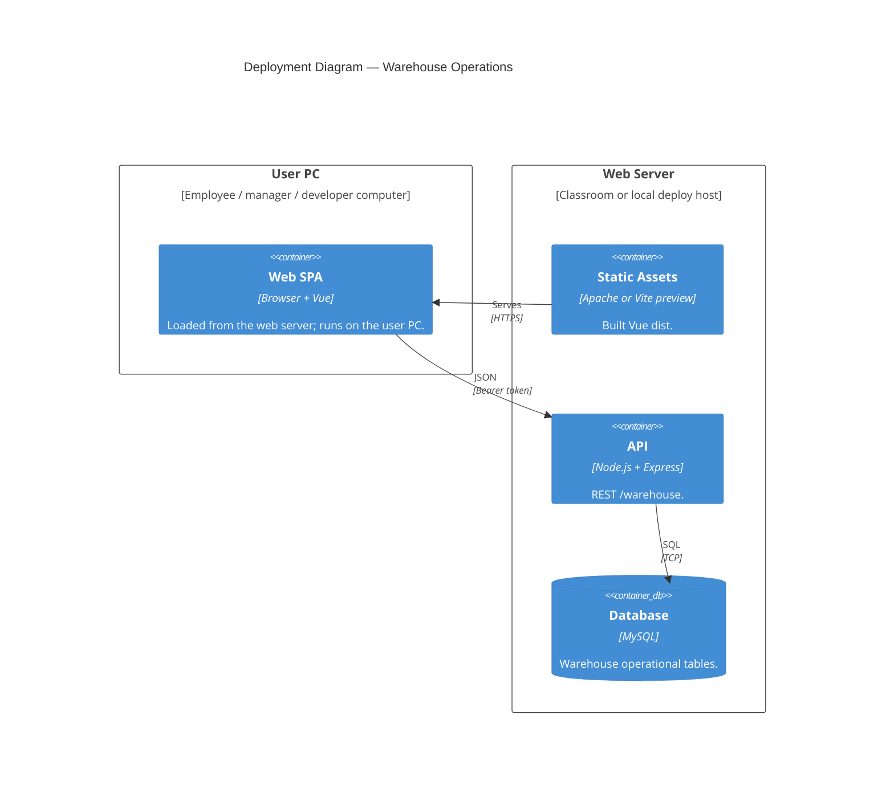

# C4 Level 4 — Deployment

The **user PC** runs the SPA in a browser. The **web server** hosts static assets, the Node API, and MySQL.

## Typical ports

| Location | Service | Port |
|----------|---------|------|
| User PC | Browser | — |
| Web Server | SPA (Vite dev or Apache) | `8082` / `80` |
| Web Server | Backend API | `3200` (or reverse-proxied) |
| Web Server | MySQL | `3306` |

**Related:** [ADR-0001](../adr/0001-client-server-warehouse-architecture.md)
