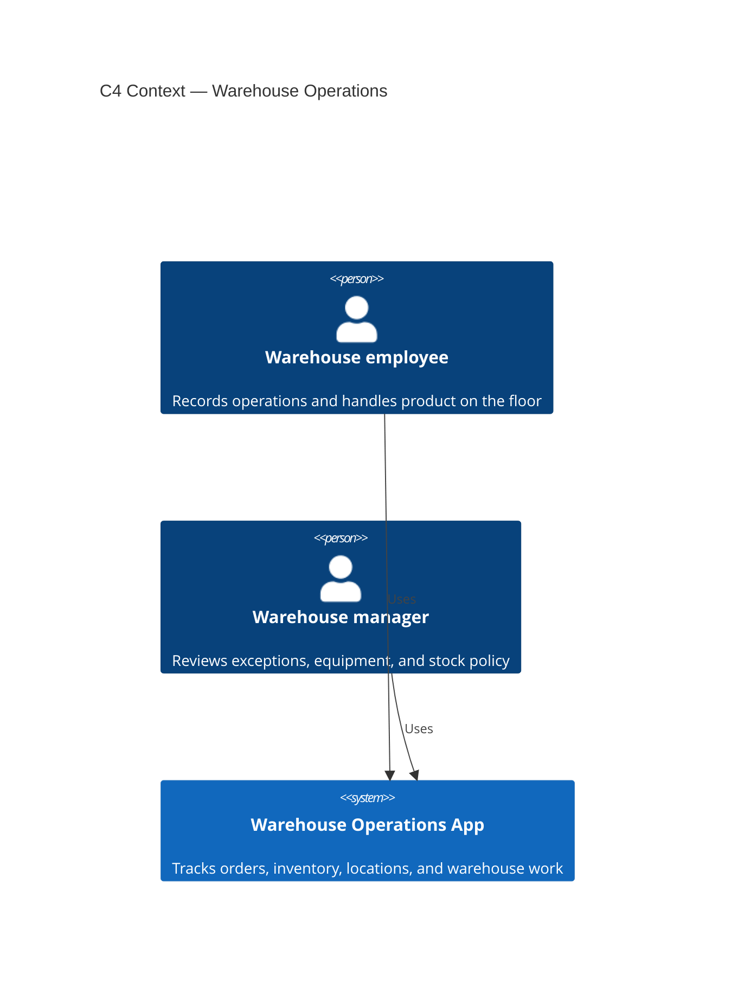

# Warehouse Architecture (Draft)

**Status:** Draft  
**Date:** 2026-11-23  
**Related:** [design.md](./design.md) · [Feature catalog](./README.md)

This file records **how** the warehouse application is shaped: clients, API, data, and roles. Product behavior lives in `feature-N-*.md`.

---

## Context

Warehouse employees and managers record orders, shipments, inventory, locations, equipment, returns, receiving, damage, expiration, and picking work. The server is the source of truth. The browser is a client only.



---

## Containers

Stack matches OC CS Speckit classroom apps: Vue SPA, Express REST API, MySQL.

| Container | Choice |
|-----------|--------|
| **Client** | Vue 3 SPA (Vite) + Vuetify |
| **Server** | Node.js + Express + Sequelize |
| **Database** | MySQL — one warehouse database |
| **Transport** | JSON over HTTP; API base path `/warehouse/` |
| **Auth (assumed)** | Signed-in employee session; `Authorization: Bearer <token>` |
| **Repo** | Specs in `WareHouse/features/`; later `frontend/` + `backend/` |

```text
Browser (Vue SPA)                 Express API                    MySQL
─────────────────                 ───────────                    ─────
route guards / role UI  ─Bearer─► authenticate + role checks  ──► operational tables
axios *Services.js                controllers + ownership helpers
```

**Invariants**

1. The **server** is the source of truth for warehouse records.
2. Every authenticated request resolves to one employee (`req.user.id`) and a role (`worker` or `manager`).
3. Warehouse **operational data is shared** among employees of this warehouse (not private per user like Todo lists).
4. The client never sends a trusted `createdBy` / `userId` on create — the server assigns the acting employee.
5. Unknown resource IDs return **`404`**. Missing auth returns **`401`**. Insufficient role returns **`403`**.

---

## Roles

| Role | Typical access |
|------|----------------|
| **Employee** (`worker`) | Create and update floor records: orders, shipments, picks, counts, damage reports, returns, receiving, locations, equipment issue reports |
| **Manager** (`manager`) | Everything an employee can do, plus inventory adjustments, damage/return disposition, equipment maintenance status, minimum stock levels |

Full login/register UX is **out of scope** of Features 1–10 (assumed from the course auth pattern). Specs still require a signed-in actor so APIs can record who did the work.

---

## Domain map (features)

```text
Locations (10) ──► Picking (4), Inventory accuracy (5)
Orders & shipments (1) ──► Receiving (8), Damage (2)
Inventory accuracy (5) ──► Low-stock alerts (6)
Returns (7), Expiration (9), Equipment (3) are independent slices
```

Shared catalog idea: a **Product** is identified by **SKU**. Features that need on-hand quantity read inventory after Feature 5 exists; until then they record quantities on their own documents.

---

## API conventions

- Flat JSON (no `{ success, data }` envelope).
- Errors: `{ "message": "Human-readable explanation." }`
- Create → `201`; update → `200`; delete → `200` or `204`; validation → `400`.
- Feature files list **only the endpoints that feature adds or changes**.

---

## Screen conventions

- Signed-in chrome: app bar with the employee name and a way to leave the session (when auth UI exists).
- Each feature names its **view**, **route**, primary **CTA** labels, and empty / loading / error copy.
- Quoted UI strings in Screen Requirements must match Gherkin.

---

## Out of scope for this architecture draft

- Multi-warehouse / multi-tenant SaaS
- Carrier booking, freight payment, and accounting
- Handheld firmware (scanners are tracked as equipment records, not device OS)
- Real-time websocket updates (HTTP request/response is enough for the draft)
